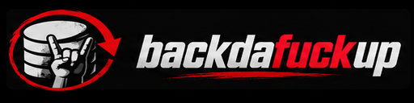

# backdafuckup



Open-source, self-hosted VM backup for **XCP-ng / XenServer** (VMware vSphere and Hyper-V planned), with a Veeam-like web console.

> Status: early development. Not ready for production use.

## Features (first milestone)

- Full and CBT-based incremental backups of XCP-ng VMs, read over NBD
- Own deduplicated, compressed chunk repository on a local volume (forever-incremental: every restore point is complete on its own)
- Scheduled backup jobs with retention
- Restore of whole VMs to the original or an alternate location
- Web console with live progress

## Build

Requires the .NET 10 SDK.

```bash
dotnet build backdafuckup.slnx
dotnet test backdafuckup.slnx
```

Development database: `docker compose -f deploy/dev/docker-compose.yml up -d` (PostgreSQL on localhost:5432).

Run the server (development mode, HTTPS on port 9555, data in `src/Backdafuckup.Server/.data`):

```bash
export ConnectionStrings__Catalog="Host=localhost;Database=backdafuckup;Username=backdafuckup;Password=backdafuckup-dev"
dotnet run --project src/Backdafuckup.Server
```

The setup token for the first administrator is printed in the log. Tests:

```bash
dotnet test --solution backdafuckup.slnx                                  # unit + integration (needs Docker)
dotnet test --solution backdafuckup.slnx --filter-not-trait "Category=Integration"   # unit only
```

Lab tests against a real XCP-ng pool are described in `docs/admin-guide.md`.

## Documentation

- Administrator guide: `docs/admin-guide.md`
- Product: `agent-os/product/` (mission, roadmap, tech stack, integration policy)
- Specs: `agent-os/specs/`

## License

backdafuckup is licensed under the **GNU Affero General Public License v3.0** (see `LICENSE`).
Contributions require signing the Contributor License Agreement, see `CONTRIBUTING.md`.
Third-party components are listed in `THIRD-PARTY-NOTICES.md`.
